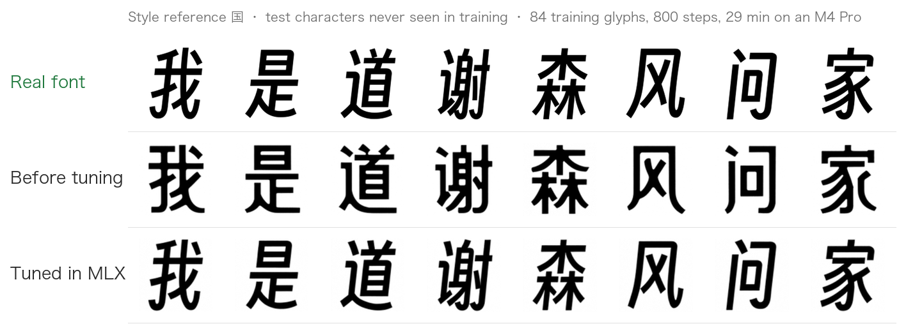

# fontdiffuser-mlx

An unofficial port of [FontDiffuser](https://github.com/yeungchenwa/FontDiffuser) (Yang et al., AAAI 2024) to
[MLX](https://github.com/ml-explore/mlx), Apple's machine learning framework. Generate Chinese characters in the
style of a reference glyph, and fine-tune the model on a few dozen glyphs of one font, on a Mac, with no PyTorch.

- **Same network, same weights.** The official checkpoints load directly. With the same inputs and starting noise,
  the output matches the official PyTorch code glyph for glyph (see [How close is it](#how-close-is-it-to-the-original)).
- **Fine-tuning on a Mac.** 84 glyphs, 800 steps: 29 minutes on an M4 Pro, in 7 GB of memory. The result is as good as
  fine-tuning with the official PyTorch code (see [Speed and memory](#speed-and-memory)).
- **Generation.** 0.86 s per character on an M4 Pro (8 at a time, 15 steps). The official PyTorch pipeline takes
  2.4 s (one at a time, 20 steps); PyTorch batched the same way takes 0.98 s.
- **Swift package.** The same model, sampling and fine-tuning in MLX Swift, so a Mac app can do both without
  Python. Checked against the Python version step by step (see [Swift](#swift-for-apps)).
- **Optional Core ML.** Put fine-tuned weights into a Core ML file without re-converting the model, for apps that
  generate with Core ML (see [Core ML](#core-ml-optional)).

This is a research tool, licensed for non-commercial research only, like the original (see [License](#license)).



<sub>Font: [Smiley Sans](https://github.com/atelier-anchor/smiley-sans) (SIL OFL 1.1). The model learned it from 84 other glyphs.</sub>

## What FontDiffuser does

You give it one glyph in the style you want (the *reference*) and the character you want, drawn in a plain font (the
*content* glyph). It draws that character in the reference's style, as a 96 × 96 image. Out of the box it copies
texture, stroke weight and slant fairly well, but not a font's structure. Fine-tuning on the glyphs of one font
(about 80 is enough in our tests) teaches it that font: the generated characters become far more consistent and,
for rule-based designs, take on the font's structure too.

## Install

Apple silicon Mac, Python 3.10 or later.

```bash
git clone https://github.com/charlie5188/fontdiffuser-mlx.git
cd fontdiffuser-mlx
pip install -e .            # add [coreml] for the Core ML tools
```

You also need, from the official project (not included here, see [License](#license)):

1. The released weights: `unet.pth`, `style_encoder.pth`, `content_encoder.pth` from the official
   [Model Zoo](https://github.com/yeungchenwa/FontDiffuser#-model-zoo) (Google Drive or Baidu Yun). Put them in one folder.
2. The content font the model was trained with: `ttf/KaiXinSongA.ttf` in the
   [official repository](https://github.com/yeungchenwa/FontDiffuser/tree/main/ttf).

Convert the weights once (no PyTorch needed; the reader only accepts plain tensors, so a checkpoint cannot run code):

```bash
fdmlx convert --ckpt-dir path/to/ckpt --out fontdiffuser.safetensors
```

## Generate

```bash
fdmlx generate --weights fontdiffuser.safetensors --content-font KaiXinSongA.ttf \
  --font MyFont.ttf --ref 永 --chars 我是道谢森风问家 --out out/
```

- `--ref-image glyph.png` instead of `--font` / `--ref`: use a photo or scan of one character (dark ink, light paper).
- `--chars-file chars.txt` for long lists. Output: one PNG per character (`U+6211.png`) and `sheet.png`.
- `--steps 15` is the default. The official setting is 20; in our tests 15 gave the same quality, 10 starts to blur.

## Fine-tune

Teach the model one font from its own glyphs. The characters in `--test` are drawn at every evaluation and are never
used for training, so you can watch the model generalise to characters it has not seen.

```bash
fdmlx finetune --weights fontdiffuser.safetensors --content-font KaiXinSongA.ttf \
  --font MyFont.ttf --train train-chars.txt --out runs/myfont \
  --test 我是道谢森风问家 --eval-refs 国永 --steps 800
```

Then generate with `--weights runs/myfont/weights.safetensors`.

Memory: `--accum` splits each batch of 16 into passes and adds up their gradients. The update is the same and the
speed almost the same; only the memory changes. 4 passes (default): about 7 GB. 2 passes: about 10 GB. 1 pass:
about 19 GB. On a 16 GB Mac, `--accum 8` should need about 4–5 GB (estimated, not tested).

Recipe: the official phase-1 objective (noise MSE + 0.5 × offset loss, 10 % condition dropout), AdamW at 2e-5,
batch 16. Not included: the VGG perceptual loss (weight 0.01) and the phase-2 SCR module.

## Core ML (optional)

Core ML cannot train, so an app that fine-tunes per user needs another way to get new weights into its Core ML model.
Converting a model with different weights does not change the Core ML program, only the numbers in its weight file.
So you can convert the network once, at development time, and afterwards write any weights into a copy of it.

1. Once, at development time, make a template and a weights map (needs PyTorch ≤ 2.7, coremltools, and the official
   repository for its model code; the template is converted from placeholder weights):

   ```bash
   python scripts/coreml_export.py --repo path/to/FontDiffuser --out unet-b8.mlpackage
   ```

2. For each set of weights (numpy only, about 0.2 s):

   ```bash
   fdmlx coreml-swap --template unet-b8.mlpackage --weights runs/myfont/weights.safetensors --out myfont.mlpackage
   fdmlx generate --coreml myfont.mlpackage --weights runs/myfont/weights.safetensors ...
   ```

   The encoders and the sampling loop still run in MLX; Core ML runs the denoiser (79 M of the 100 M parameters,
   called once per step). The swap is plain byte writes at the offsets listed in `unet-b8.weights-map.json`,
   so an app can do it in any language, with no converter on the user's machine.

This relies on how coremltools lays out its weight file. It is not an official Core ML feature.

Tested on an M4 Pro with weights fine-tuned in MLX: the swapped model gives the same glyphs as MLX (same scores against
the real font; per-call difference about 1 %, from Core ML's fp16), and the swap takes 0.1–0.2 s. On the GPU the
denoiser call is about 1.4× faster than in MLX. On this Mac the Neural Engine is slower than the GPU; it may do
better on Macs with fewer GPU cores (not tested). The first load of a package takes about 20 s while macOS compiles
it; later loads are fast.

## Swift (for apps)

The same model, sampler and fine-tuning in [MLX Swift](https://github.com/ml-explore/mlx-swift), as a Swift
package (`FontDiffuserMLX`) and a command-line tool (`fdmlx-swift`). It reads and writes the same `.safetensors`
files: weights converted or fine-tuned in Python load in Swift, and the other way round.

In an app, add the package `https://github.com/charlie5188/fontdiffuser-mlx` (product `FontDiffuserMLX`):

```swift
import FontDiffuserMLX
import MLX

let model = FontDiffuser()
try model.load(weights: weightsURL)             // from `fdmlx convert`, or fine-tuned
model.train(false)
let content = try GlyphFont(url: kaiXinSongURL).glyphs("我是道谢")
let style = try styleReference(fromImage: photoURL)   // or try GlyphFont(url: fontURL).glyphs("永")
let noise = MLXRandom.normal([4, 96, 96, 3])
let glyphs = Sampler(model: model)(content: content, style: style, noise: noise, steps: 15)
try glyphs.writePNG(0, to: outputURL)
```

To fine-tune, create a `FineTuner(model:target:content:)` with the training glyphs and call `step()` once per
step. `swift/fdmlx-swift/main.swift` shows the whole loop, with evaluation sheets.

The command-line tool has the same options as the Python one:

```bash
swift/build-without-xcode.sh
.build/release/fdmlx-swift generate --weights fontdiffuser.safetensors --content-font KaiXinSongA.ttf \
  --font MyFont.ttf --ref 永 --chars 我是道谢森风问家 --out out/
.build/release/fdmlx-swift finetune --weights fontdiffuser.safetensors --content-font KaiXinSongA.ttf \
  --font MyFont.ttf --train train-chars.txt --out runs/myfont --test 我是道谢森风问家 --eval-refs 国永
```

Building: MLX Swift compiles its GPU kernels with the Metal compiler that comes with Xcode. With Xcode, build as
usual (the standard route for MLX Swift; not tested here). With only the Command Line Tools,
`swift/build-without-xcode.sh` builds everything else and fetches the same kernels, prebuilt, from the official MLX
Python wheel of the same MLX version. This is how the Swift version was built and tested.

Checked against the Python version with the same weights and inputs (`swift/checks`, see [Checks](#checks)):

| Check | Swift vs Python |
|---|---|
| Resizing glyphs to 96 px (Pillow's bilinear filter) | identical |
| Encoders, noise prediction | max relative difference 3e-6 |
| Sampling, 15 steps, same starting noise | 0.02 % of pixels differ, by 1 grey level of 255 |
| Training loss / all 832 gradients | 5e-7 / median 6e-6 |
| One training step (2 passes, clipping, AdamW, spectral norm) | same loss, every weight moved the same way |
| Glyph rendering (Core Text instead of FreeType) | mean difference 0.5 grey level of 255, ink overlap 0.987 |

End to end, on the same M4 Pro, idle, measured the same day:

| | Python | Swift |
|---|---|---|
| Fine-tuning Smiley Sans, 84 glyphs, 800 steps | 29 min, 7.3 GB | 28 min, 7.1 GB |
| Overlap with the real font, 8 held-out characters, ref 国 / 永 | 0.700 / 0.693 | 0.705 / 0.696 |
| Structure score, ref 国 / 永 | 0.969 / 0.959 | 0.964 / 0.951 |
| Generation, 8 at a time, 15 steps (median of 3 runs) | 0.89 s per character | 0.89 s per character |

The two fine-tuning runs drew their training samples in different random orders, so the small score differences
are run-to-run variation. With the same weights and starting noise, the glyphs the two versions draw overlap 0.995;
the rest is the glyph rendering.

Differences from the Python version:

- Glyphs are rendered with Core Text, so edge anti-aliasing differs slightly (table above).
- Random numbers come from MLX's generator and a seeded generator of its own, not numpy's, so the same `--seed`
  gives different starting noise and a different training order than in Python. To compare runs, pass the same
  noise as a `.npy` file (`--noise`, `--eval-noise`).
- Not in Swift: converting PyTorch checkpoints (do it once with `fdmlx convert`) and the Core ML weight swap
  (plain byte writes at the offsets in the weights map; see [Core ML](#core-ml-optional)).

## How close is it to the original?

`tests/parity.py` runs both on the same inputs with the official weights (PyTorch fp32 on the CPU, MLX fp32 on the GPU):

| Check | Max relative difference |
|---|---|
| Deformable convolution (vs torchvision): output, gradients for input, offsets, weight | < 5e-7 |
| Style encoder / content encoder output | 5e-7 |
| Noise prediction (whole UNet) | 3e-6 |
| Training loss | 1e-7 |
| All 832 parameter gradients | median 7e-6 |

The few gradients that differ more (up to 4 %) belong to the offset branch of the deformable convolutions. The
released model's offsets are about 1e-4 px, so those gradients are sums of large terms that nearly cancel. Against a
float64 run of the official code, official float32 is itself about 5 % off there, and MLX float32 the same.

End to end, with the same reference glyph and starting noise, the fine-tuned Smiley Sans model draws the same eight
characters in MLX as in PyTorch (overlap 1.00).

## Speed and memory

Apple M4 Pro, 48 GB, idle. PyTorch 2.15 on the Mac GPU (MPS), MLX 0.32, coremltools 9.

**Fine-tuning** (84 glyphs, batch 16, 800 steps, including four evaluation sheets):

| | Time per step | Whole run | Peak memory |
|---|---|---|---|
| Official PyTorch code | 5.6 s | 80 min | – |
| PyTorch with a GPU deformable conv (1) | 1.7 s | 26 min | 17.6 GB |
| MLX, 16 glyphs per pass | 1.9 s | – | 19 GB |
| MLX, 4 glyphs per pass (default) | 1.95 s | 29 min | 7.3 GB |

(1) torchvision's deformable convolution has no backward pass on the Mac GPU, so the official code falls back to
the CPU at every step. A pure-PyTorch version removes that. MLX is about 15 % slower per step than this patched
PyTorch; most of the gap is MLX's deformable convolution, built from gathers (about 10× the cost of a plain
convolution of the same size). Splitting the batch into passes costs almost no speed.

Quality after fine-tuning, on 8 held-out characters (overlap of ink with the real font, and a structure score):

| Fine-tuned with | Overlap, ref 国 / 永 | Structure, ref 国 / 永 |
|---|---|---|
| PyTorch (official model code) | 0.690 / 0.680 | 0.952 / 0.946 |
| MLX | 0.700 / 0.693 | 0.969 / 0.959 |

Same glyphs by eye. The MLX run draws its training samples in a different random order, so treat the small gap
as run-to-run variation, not an improvement.

**Generation** (8 characters per batch, seconds per character):

| | 20 steps | 15 steps | One denoiser call (batch 16) |
|---|---|---|---|
| Official PyTorch pipeline (one character at a time) | 2.43 | – | – |
| PyTorch, batched, encoders run once | 1.23 | 0.98 | 0.60 |
| MLX | 1.17 | 0.86 | 0.49 |
| MLX + Core ML on the GPU | 0.86 | 0.65 | 0.34 |
| MLX + Core ML on the Neural Engine | 1.79 | 1.34 | 0.71 |

Half precision (fp16 or bf16) made no difference to MLX's speed here, and the model stays in fp32.

## Differences from the official code

- Channels-last layout throughout (MLX's native layout); conv weights are transposed on load.
- The deformable convolution is built from gathers and a matrix multiply, since MLX has none. Out-of-range sampling
  follows torchvision exactly.
- The sampler computes DPM-Solver++'s per-step coefficients in float64 on the CPU and runs the encoders once per
  batch instead of once per step (their inputs do not change between steps).
- Glyphs are rendered with Pillow instead of pygame; edge anti-aliasing can differ by a grey level.
- Not ported: training from scratch (phase 1 at full scale, phase 2 with SCR), sliced attention, the Gradio demo.

Kept on purpose, because the released weights were trained with them: the style encoder applies its last layer twice,
and the encoders' spectral-norm layers update their power-iteration vector in training mode.

## Related

[songlairui/fontdiffuser-mlx](https://github.com/songlairui/fontdiffuser-mlx) is an earlier, independent MLX port
that focuses on generation.

## Checks

For development; they need PyTorch, torchvision, diffusers 0.22 and a clone of the official repository.

- `tests/parity.py`: MLX against the official code, layer outputs and all gradients (the table above).
- `tests/gen_check.py`: generate from the same glyphs and starting noise as a PyTorch run, to compare sheets.
- `tests/bench_gen.py`: generation timing. `tests/coreml_check.py`: Core ML against MLX, output and timing.
- Swift against Python (needs only the Python package): `tests/swift_fixtures.py` writes the Python results
  (about 800 MB), then `.build/release/fdmlx-swift-check` with the same arguments plus `--fixtures` compares
  rendering, encoders, sampling, gradients and one training step (the Swift table above).

## License

FontDiffuser's code and weights are © 2023 DLVC-Lab, South China University of Technology. The official repository
states that it "can only be used for non-commercial research purposes" and that commercial use needs permission
from Prof. Lianwen Jin. This port is a derivative of that code and follows the same terms: **non-commercial research
use only**. It contains no model weights and no fonts. See [LICENSE](LICENSE).

## Citation

```bibtex
@inproceedings{yang2024fontdiffuser,
  title={FontDiffuser: One-Shot Font Generation via Denoising Diffusion with Multi-Scale Content Aggregation and Style Contrastive Learning},
  author={Yang, Zhenhua and Peng, Dezhi and Kong, Yuxin and Zhang, Yuyi and Yao, Cong and Jin, Lianwen},
  booktitle={Proceedings of the AAAI conference on artificial intelligence},
  year={2024}
}
```
